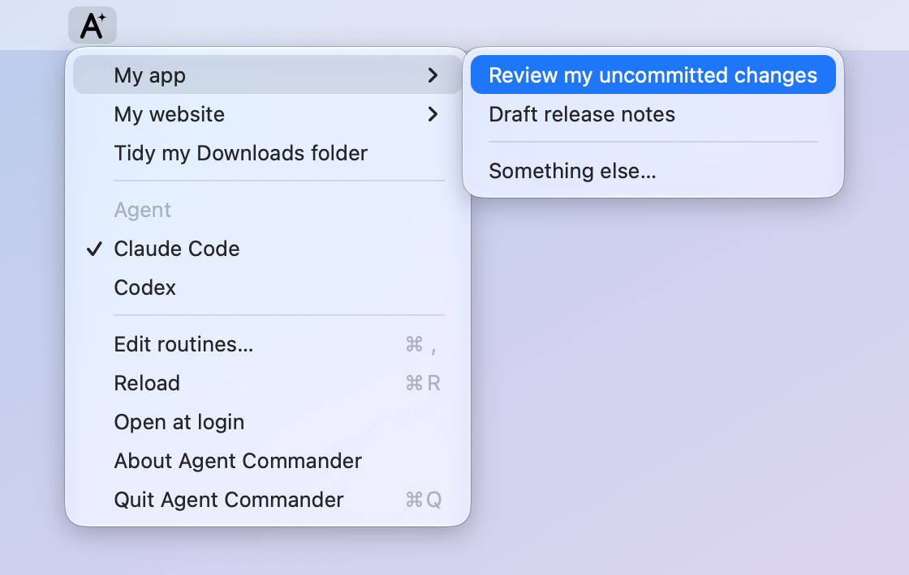

# Agent Commander

A small Mac menu bar app for starting AI coding agents on the jobs you do
over and over.

Pick a project, then one of its saved routines. Terminal opens in that
project's folder with your agent (Claude Code, Codex, or any other
command-line agent) already working on the routine's instructions. You watch
it work and answer its questions, just as if you'd typed the command
yourself.



It only runs when you click. There are no schedules, nothing runs in the
background, and it doesn't collect or send anything anywhere.

## Why

If you use an agent for regular chores ("publish my blog post", "review my
changes", "update the docs"), you end up opening Terminal, changing to the
right folder, starting the agent and pasting the same request every time.
Agent Commander turns each of those into one menu click.

## Install

### From the release (easiest)

1. Download `Agent-Commander-1.1.0.zip` from the
   [latest release](https://github.com/rsmith4321/agent-commander/releases/latest).
2. Double-click the zip and drag **Agent Commander** into your Applications
   folder.
3. The app isn't signed by Apple, so the first launch needs one extra step:
   right-click (or Control-click) the app, choose **Open**, then **Open**
   again. On newer macOS versions, if that doesn't offer an Open button, try
   to open it once, then go to **System Settings → Privacy & Security** and
   click **Open Anyway**.

An "A" appears in your menu bar. After that it opens normally.

You need macOS 13 or later and at least one agent installed, for example
[Claude Code](https://docs.anthropic.com/en/docs/claude-code) or
[Codex](https://github.com/openai/codex).

### From source

You need Apple's command line tools (`xcode-select --install`).

```bash
git clone https://github.com/rsmith4321/agent-commander.git
cd agent-commander
./build.sh
```

`build.sh` builds the app, copies it to `~/Applications`, and starts it.
`./build.sh --release` makes a universal (Apple silicon and Intel) zip in
`build/` instead.

## Using it

- Click the "A" in the menu bar, choose a project, then a routine.
- Tick the agent you want under **Agent**. Every routine uses it until you
  pick another, and Agent Commander remembers your choice.
- A routine set to ask (like **Something else…**) shows a box where you type
  what you want done.
- **Edit routines…** opens your settings file. Changes appear the next time
  you open the menu, or right away with **Reload**.
- **Open at login** starts Agent Commander when you log in.
  (Setting up a Mac with a script? `open -a "Agent Commander" --args
  --open-at-login on` does the same.)

If something is wrong, it tells you: a mistake in the settings file shows up
at the top of the menu with details, an agent it can't find is marked "(not
found)", and a routine whose folder is missing (say, an unplugged drive) gets
a clear message instead of a broken Terminal window.

## Settings

Everything lives in one file: `~/.config/agent-commander/config.json`. The
first time the app runs it writes an example there, along with a `README.md`
that explains every option. Here is a small example:

```json
{
  "agents": [
    { "name": "Claude Code", "command": "claude" },
    { "name": "Codex", "command": "codex" }
  ],
  "defaultAgent": "Claude Code",
  "projects": [
    {
      "name": "My app",
      "folder": "~/Projects/my-app",
      "routines": [
        {
          "title": "Review my uncommitted changes",
          "prompt": "Review the uncommitted changes in this repo. Point out bugs, but don't edit anything."
        },
        "-",
        { "title": "Something else…", "prompt": null }
      ]
    },
    {
      "name": "My website",
      "folder": "~/Projects/my-site",
      "routines": [
        { "title": "Check for broken links", "prompt": "Find broken links and list them. Don't change anything." }
      ]
    }
  ]
}
```

**Agents** need a `name` for the menu and a `command` that starts them.
Agent Commander finds commands the same way your Terminal does. If it can't,
give the full path, like `"$HOME/.local/bin/claude"`. Commands can include
options (`"claude --model opus"`). The prompt is added at the end; if your
agent wants it somewhere else, put `{prompt}` where it goes.
`defaultAgent` picks which one is ticked at first.

**Projects** have a `name`, a `folder` where Terminal starts, and their
`routines`. With one project, its routines sit right in the menu; with
several, each project gets a submenu.

**Routines** have a `title` and a `prompt`. Set `"prompt": null` to type the
request each time.

**Extras:**

- `"-"` adds a separator line, `{ "header": "Publishing" }` adds a gray
  label, and `{ "submenu": "More", "routines": [...] }` makes a submenu.
- A routine can have its own `"folder"`, or `"agent": "Codex"` to always use
  that agent whatever is ticked.
- A top-level `"routines"` list holds routines that don't belong to any
  project. They show in the main menu.
- `"menuBarIcon"` swaps the "A" for an [SF Symbol](https://developer.apple.com/sf-symbols/),
  for example `"sparkles"`.

JSON has no comments, so notes go in keys starting with `_`, such as
`"_comment": "..."`. They're ignored.

## How it works

When you pick a routine, Agent Commander writes a tiny one-time script and
opens it with Terminal. The script changes to the routine's folder and runs
the agent with your prompt, then deletes itself. Opening a script file this
way doesn't need any special macOS permissions. The prompt is quoted safely,
so quotes, dollar signs and other symbols reach the agent exactly as written.

The app is two small Swift files: [`Sources/main.swift`](Sources/main.swift)
and [`Sources/Glyph.swift`](Sources/Glyph.swift), which draws the "A" for
both the menu bar and the app icon (`Tools/make-icon.sh` rebuilds the icon).

## Compared to Rota

[Rota](https://github.com/wiltodelta/rota) is a much bigger menu bar app
that runs agent routines **on a schedule**, in the background, and shows
each run as a chat you can read and reply to later. It's a good fit when you
want jobs to happen on their own at set times.

Agent Commander is the opposite: **on demand and interactive**. Nothing
happens until you click, and the agent runs in a normal Terminal window in
front of you, so you can watch it and answer questions as it goes. There's
no scheduler, no session history and no settings window, just a menu and a
text file.

## License

[MIT](LICENSE). Copyright (c) 2026 Ryan Smith.
